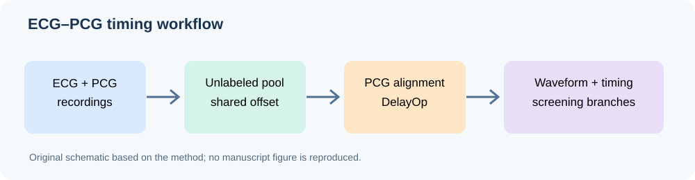
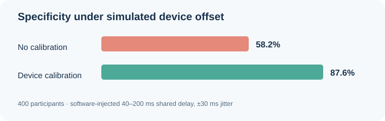

# Label-Free Device-Level Temporal Self-Calibration for ECG–PCG Fusion

Research code accompanying the manuscript **“Label-Free Device-Level Temporal Self-Calibration for Asynchronous ECG–PCG Fusion in Heart Failure Screening.”** The manuscript itself is not included in this repository.



## Why timing matters

An acquisition delay in the phonocardiogram (PCG) can lengthen the apparent interval from the ECG R peak to the first heart sound (S1). A screening model trained on synchronized recordings may interpret that extra delay as a disease cue. This repository implements device-level offset calibration from an unlabeled pool, waveform alignment, and a separate timing branch that retains physiological variation.

## Evaluation at a glance



In the manuscript's 400-participant evaluation, software-injected shared PCG delays of 40–200 ms plus ±30 ms per-recording jitter reduced specificity for the uncalibrated full model to 58.2%. Device-level calibration restored it to 87.6% at 78.4% sensitivity. The community evaluation included 100 scored participants but only four positive cases, so its sensitivity estimate is imprecise. Peak and cross-correlation calibration performed similarly to the learned DelayOp; the experiments do **not** establish superiority of the learned estimator. These are simulated timing offsets, not a prospective dual-device ECG–PCG deployment.

## Repository map

| Path | Role |
| --- | --- |
| `epcg/` | ECG/PCG preprocessing and model components used by the scripts |
| `experiments/E49_pinet_timing` through `E79_modality_dropout` | Dependencies of the reported model and comparison scripts |
| `experiments/E81_controlled/run.py` | Main offset and calibration comparison |
| `experiments/E82_hard_calibration/run.py` | Calibration-pool, jitter, and noise stress tests |
| `experiments/E83_community/run.py` | Community-cohort evaluation |
| `experiments/E84_supervisor_exp3/` | Metric audit, module ablation, and pool-composition analysis |
| `environment.yml` | Original Python and PyTorch environment specification |

The numbered dependency directories are retained because the experiment scripts import them directly. This public repository excludes patient-level outputs, trained weights, private project logs, earlier manuscript drafts, and plans for other work.

## Data and environment

The ECG–PCG HFrEF main and community datasets are available from [Zenodo record 16934966](https://zenodo.org/records/16934966). Place the extracted data under `data/raw/hfref/`, or set `EPCG_DATA_ROOT` to another data root. Other public sources used by dependency scripts are registered in `epcg/io/registry.py`. Dataset terms remain those of their original providers.

```bash
conda env create -f environment.yml
conda activate epcg
python -c "import torch; print(torch.__version__)"  # expected 2.6.0
```

From the repository root, run the main training and evaluation script, then its analyses in order:

```bash
python experiments/E81_controlled/run.py
python experiments/E82_hard_calibration/run.py
python experiments/E83_community/run.py
python experiments/E84_supervisor_exp3/audit.py
python experiments/E84_supervisor_exp3/modules.py
python experiments/E84_supervisor_exp3/pool_mix.py
```

`--smoke` is available on the main scripts for pipeline checks. Full reproduction requires the original dataset and, for analyses that reuse frozen predictions or model weights, the relevant prior experiment outputs. These artifacts are held in the separate supervisor backup; they are not distributed here. The historical E47 and E73 model weights were not retained.

## Scope

The code and original diagrams in this README illustrate the reported workflow. The confidential manuscript PDF and its publication figures are not part of the repository.
